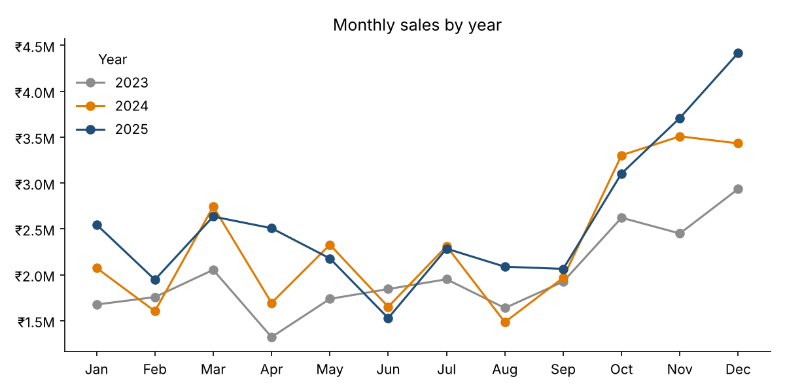
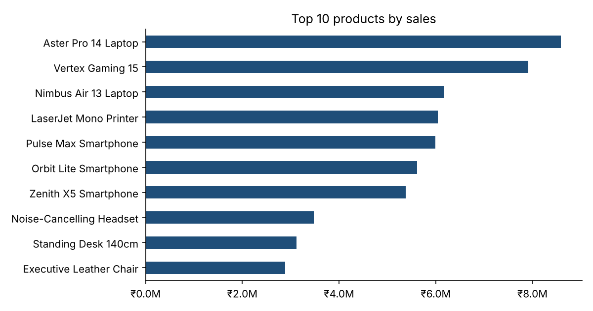
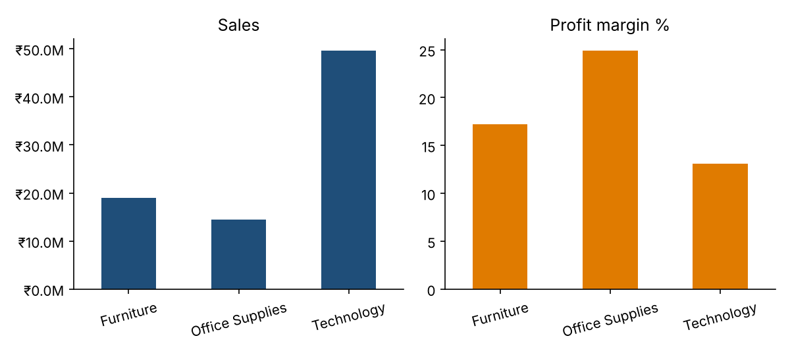
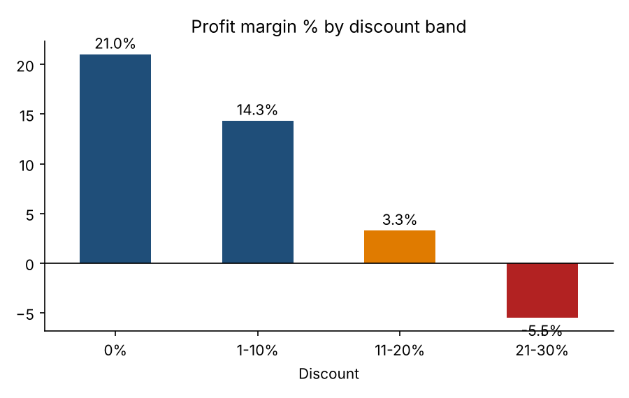
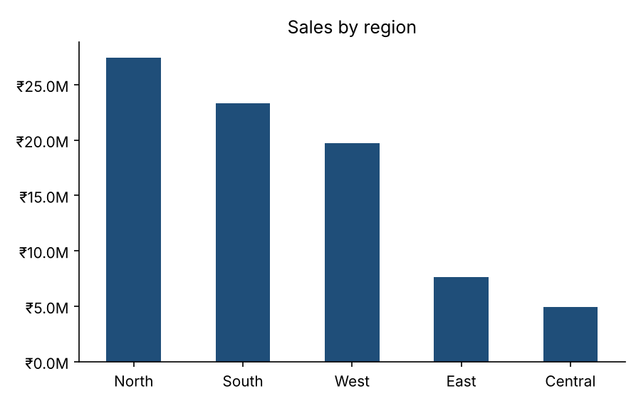

# Insights Summary

All figures come from the cleaned dataset (12,535 order lines, 7,159 orders, 900 customers, Jan 2023 - Dec 2025). Total sales Rs 83.02M, profit Rs 13.37M, margin 16.1%, average order value Rs 11,596.

## 1. Sales are growing, but growth is slowing
Sales rose from Rs 23.9M (2023) to Rs 28.1M (2024) and Rs 31.0M (2025): +17.5% then +10.4%. Growth is healthy but decelerating.
**Action:** set a 2026 target near +10% and look for a new growth lever rather than assuming the 2024 pace continues.

{width=85%}

## 2. The festive quarter carries the year
October-December generates 35.5% of annual sales; December is the strongest month and June the weakest. March also spikes (fiscal year-end purchasing).
**Action:** build inventory and staffing for Q4 early, and run low-season campaigns in May-July.

## 3. Sales are concentrated in a few products
The top 3 products (Aster Pro 14 Laptop, Vertex Gaming 15, Nimbus Air 13 Laptop) contribute 27.3% of sales; the top product alone is 10.3%. Five of the top six are Technology items.
**Action:** protect supply of these SKUs; a stock-out on one would visibly dent revenue.

{width=85%}

## 4. Technology sells most but earns least per rupee
Technology is 59.7% of sales but has the lowest margin (13.1%). Office Supplies is only 17.5% of sales but earns the best margin (24.9%); Furniture sits at 17.2%.
**Action:** bundle high-margin Office Supplies with laptop and phone purchases to lift blended margin.

{width=85%}

## 5. Heavy discounting destroys profit (the key finding)
Profit margin falls from 21.0% with no discount to 14.3% at 1-10%, 3.3% at 11-20%, and **-5.5% at 21-30%**. All 417 loss-making order lines (3.3% of lines, Rs 212,870 of losses) sit in discount bands above 10%, and 15.3% of all lines carry a discount of 20% or more.
**Action:** cap discounts at 10% unless approved; this removes every loss-making line in this dataset.

{width=70%}

## 6. Geography: North and South lead, East and Central lag
North (33.1%) and South (28.1%) account for over 61% of sales. Maharashtra (14.4%), Karnataka (11.3%) and Delhi (11.1%) are the top states; Bihar (1.1%) and Odisha (2.1%) are the smallest.
**Action:** East and Central are under-penetrated - test local campaigns or delivery partnerships before investing heavily.

{width=65%}

## 7. Customers: consumers dominate
Consumer customers drive 51.6% of sales, Corporate 27.9% and Home Office 20.5%. Segments differ mainly by customer count (471, 246 and 183 customers), so growth depends on acquiring customers rather than on basket size.

## Limitations
- The dataset is synthetic, so these insights illustrate the method; with a real dataset the numbers (and conclusions) will differ.
- 140 rows (1.1%) were quarantined; their approximate value (Rs 1.05M) is excluded from all totals.
- Profit uses the dataset's own profit column; no cost-of-goods detail was available to re-derive it.
