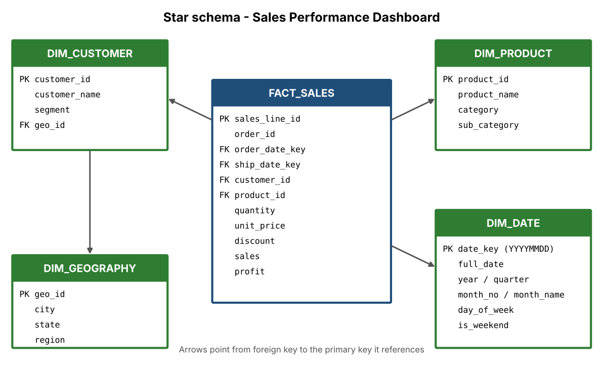
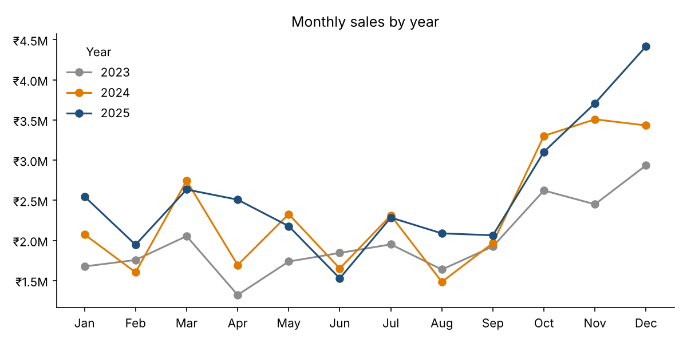
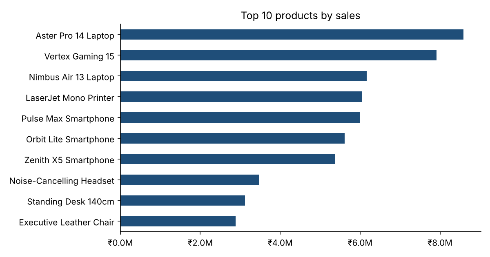
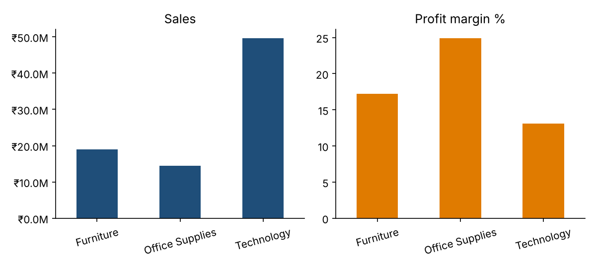
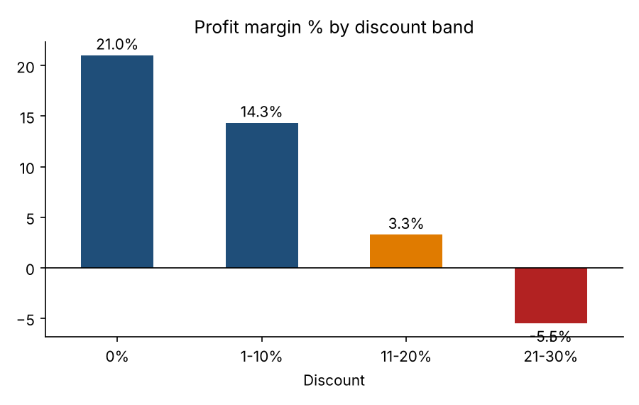
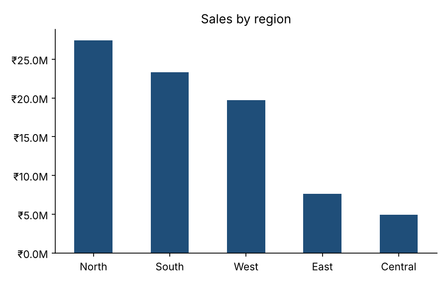

**GitHub repository:** [PASTE YOUR GITHUB REPOSITORY LINK HERE]
**Domain:** Retail and e-commerce (Project 1)

# Problem Statement and KPI Definitions

## Business problem
A mid-sized Indian retailer selling Technology, Furniture and Office Supplies across 16 states has sales data spread over raw transaction exports. Management cannot quickly answer: **How are sales and profit trending? Which products, regions and customer segments drive revenue? Is discounting helping or hurting profit?**

## Objective
Build an end-to-end analytics solution - Python (cleaning) -> Oracle SQL (star schema and analysis) -> Power BI (interactive dashboard) - that answers these questions and whose numbers reconcile across all three tools.

## Scope
- Period: 1 Jan 2023 - 31 Dec 2025 (36 months)
- Grain: one row per order line
- Currency: Indian Rupees (INR)

## KPI definitions

| # | KPI | Definition | Formula |
|---|-----|-----------|---------|
| 1 | Total Sales | Revenue after discount | SUM(sales) |
| 2 | Total Profit | Revenue minus cost | SUM(profit) |
| 3 | Profit Margin % | Profit as a share of sales | SUM(profit) / SUM(sales) x 100 |
| 4 | Total Orders | Distinct orders placed | COUNT(DISTINCT order_id) |
| 5 | Average Order Value (AOV) | Sales per order | SUM(sales) / COUNT(DISTINCT order_id) |
| 6 | Units Sold | Items sold | SUM(quantity) |
| 7 | Active Customers | Distinct buying customers | COUNT(DISTINCT customer_id) |
| 8 | MoM Growth % | Change vs previous month | (this month - last month) / last month x 100 |
| 9 | YoY Growth % | Change vs same month last year | (this - last year) / last year x 100 |
| 10 | Discount Margin Gap | Margin of discounted lines vs undiscounted | margin(discount > 0) - margin(discount = 0) |

## Dashboard questions mapped to visuals

| Business question | Visual | SQL |
|---|---|---|
| Headline performance | 6 KPI cards | Q1 |
| Trend over time | Line chart by month, year as legend | Q2, Q7, Q8 |
| Best products | Top 10 bar chart | Q3, Q11 |
| Where do we sell | Region bar + state map/table | Q4, Q5 |
| Which categories earn | Category/sub-category margin | Q6 |
| Who buys | Segment donut | Q9 |
| Is discounting hurting | Margin by discount band | Q10 |

## Slicers
Year, Region, Category, Customer Segment (4 slicers; requirement is 3). Drill-down: Category -> Sub-category -> Product; Region -> State -> City; Year -> Quarter -> Month.

# Data Model

{width=95%}

Fact table FACT_SALES (one row per order line) with four dimensions: DIM_DATE, DIM_PRODUCT, DIM_CUSTOMER and DIM_GEOGRAPHY (customer to geography). Primary keys, foreign keys and CHECK constraints are in `sql/01_create_tables.sql`.

# Data Quality Report

## 1. Source
`data/raw_sales.csv` - 12,865 rows x 18 columns of retail order lines (Jan 2023 - Dec 2025).
The dataset in this repository is **synthetic**, generated by `src/01_generate_raw_data.py` with realistic seasonality and deliberately injected errors, so that every cleaning rule can be demonstrated and verified. The pipeline works unchanged on a real Kaggle retail CSV that has the same 18 columns.

## 2. Issues found and how each was handled

| Rule | Issue found | Rows | Action |
|---|---|---:|---|
| - | Raw rows loaded | 12,865 | baseline |
| R1 | Exact duplicate rows | 190 | Removed (first occurrence kept) |
| R2 | Order dates in non-ISO formats (DD-MM-YYYY, YYYY/MM/DD, Mon DD, YYYY) | 507 | Parsed and converted to YYYY-MM-DD |
| R3 | Impossible / unparseable dates (e.g. 31-02-2024) | 6 | Quarantined |
| R4 | Region with wrong casing / extra spaces | 379 | Trimmed + Title Case |
| R5 | Missing region | 152 | Filled from state->region mapping |
| R6 | Missing customer_id | 50 | Quarantined |
| R7 | Missing sub_category | 63 | Filled from product_id lookup |
| R9 | Negative sales amounts | 76 | Quarantined |
| R8 | Missing discount | 75 | Derived from sales, quantity, unit_price |
| R10 | Sales inconsistent with quantity x price x (1-discount) (outliers) | 8 | Quarantined |
| R11 | ship_date earlier than order_date | 0 | Quarantined |
| - | Clean rows delivered | 12,535 | data/clean_sales.csv |
| - | Rows quarantined (all rules) | 140 | data/rejected_rows.csv |

**Result:** 12,865 raw rows -> 12,535 clean rows + 140 quarantined + 190 duplicates removed.

### Quarantined rows (kept in `data/rejected_rows.csv`, never silently dropped)

| Reject reason | Rows |
|---|---:|
| R9 negative sales | 76 |
| R6 missing customer_id | 50 |
| R10 sales outlier / inconsistent | 8 |
| R3 impossible date | 6 |

## 3. Why these decisions
- **Duplicates removed, not summed:** identical rows across all 18 columns are repeat exports, not repeat purchases.
- **Missing region filled, missing customer quarantined:** state determines region (one-to-one), so the value is recoverable with certainty. A missing customer_id cannot be reliably recovered, so guessing would corrupt customer counts.
- **Negative sales quarantined, not sign-flipped:** a negative amount could be a return or a typo; the data cannot tell which, so it is held out and reported.
- **Outliers detected by a consistency rule, not by a statistical cut-off:** sales must equal quantity x unit_price x (1 - discount) within 1%. This catches the "extra zero" typo exactly without deleting genuine large orders (e.g. 2 gaming laptops).

## 4. Reconciliation (the 0.1% acceptance test)

| Check | Result |
|---|---|
| Python clean total = SQL Q1 total (SQLite stand-in for Oracle) | 83,017,884.76 vs 83,017,884.76 - **0.0000% diff** |
| Sum of regions, segments, categories, months, states, discount bands = total | **All 0.0000% diff** (`python src/03_validate_sql_logic.py`) |
| Clean total vs original pre-dirt total | 1.25% lower - fully explained by the 140 quarantined rows (approx. Rs 1,047,472 of value vs Rs 1,047,457 gap) |
| Oracle total (run on your machine) | Compare with `output/expected_kpis.csv` using the PL/SQL block in `sql/03_views.sql` |
| Power BI KPI card (run on your machine) | Must equal `expected_kpis.csv` Total Sales |

**Row-count reconciliation:** 12,865 raw - 190 duplicates - 140 quarantined = 12,535 clean = rows in `fact_sales`.

# Insights Summary

All figures come from the cleaned dataset (12,535 order lines, 7,159 orders, 900 customers, Jan 2023 - Dec 2025). Total sales Rs 83.02M, profit Rs 13.37M, margin 16.1%, average order value Rs 11,596.

## 1. Sales are growing, but growth is slowing
Sales rose from Rs 23.9M (2023) to Rs 28.1M (2024) and Rs 31.0M (2025): +17.5% then +10.4%. Growth is healthy but decelerating.
**Action:** set a 2026 target near +10% and look for a new growth lever rather than assuming the 2024 pace continues.

{width=85%}

## 2. The festive quarter carries the year
October-December generates 35.5% of annual sales; December is the strongest month and June the weakest. March also spikes (fiscal year-end purchasing).
**Action:** build inventory and staffing for Q4 early, and run low-season campaigns in May-July.

## 3. Sales are concentrated in a few products
The top 3 products (Aster Pro 14 Laptop, Vertex Gaming 15, Nimbus Air 13 Laptop) contribute 27.3% of sales; the top product alone is 10.3%. Five of the top six are Technology items.
**Action:** protect supply of these SKUs; a stock-out on one would visibly dent revenue.

{width=85%}

## 4. Technology sells most but earns least per rupee
Technology is 59.7% of sales but has the lowest margin (13.1%). Office Supplies is only 17.5% of sales but earns the best margin (24.9%); Furniture sits at 17.2%.
**Action:** bundle high-margin Office Supplies with laptop and phone purchases to lift blended margin.

{width=85%}

## 5. Heavy discounting destroys profit (the key finding)
Profit margin falls from 21.0% with no discount to 14.3% at 1-10%, 3.3% at 11-20%, and **-5.5% at 21-30%**. All 417 loss-making order lines (3.3% of lines, Rs 212,870 of losses) sit in discount bands above 10%, and 15.3% of all lines carry a discount of 20% or more.
**Action:** cap discounts at 10% unless approved; this removes every loss-making line in this dataset.

{width=70%}

## 6. Geography: North and South lead, East and Central lag
North (33.1%) and South (28.1%) account for over 61% of sales. Maharashtra (14.4%), Karnataka (11.3%) and Delhi (11.1%) are the top states; Bihar (1.1%) and Odisha (2.1%) are the smallest.
**Action:** East and Central are under-penetrated - test local campaigns or delivery partnerships before investing heavily.

{width=65%}

## 7. Customers: consumers dominate
Consumer customers drive 51.6% of sales, Corporate 27.9% and Home Office 20.5%. Segments differ mainly by customer count (471, 246 and 183 customers), so growth depends on acquiring customers rather than on basket size.

## Limitations
- The dataset is synthetic, so these insights illustrate the method; with a real dataset the numbers (and conclusions) will differ.
- 140 rows (1.1%) were quarantined; their approximate value (Rs 1.05M) is excluded from all totals.
- Profit uses the dataset's own profit column; no cost-of-goods detail was available to re-derive it.

# Reconciliation Screenshot

_Paste here: Power BI Total Sales card, Oracle Q12 result and output/expected_kpis.csv side by side._
